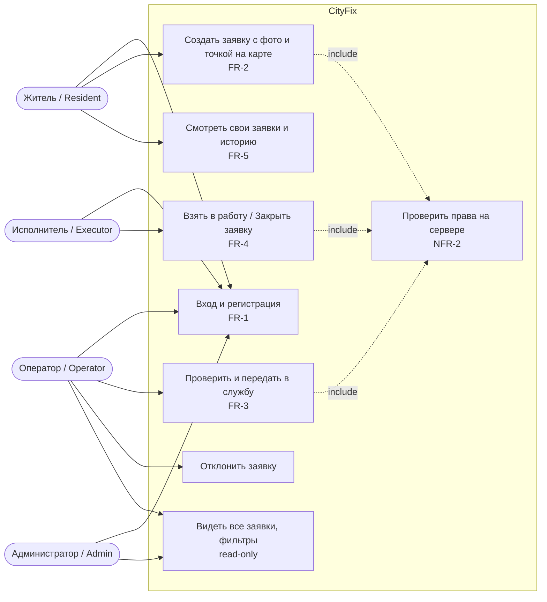
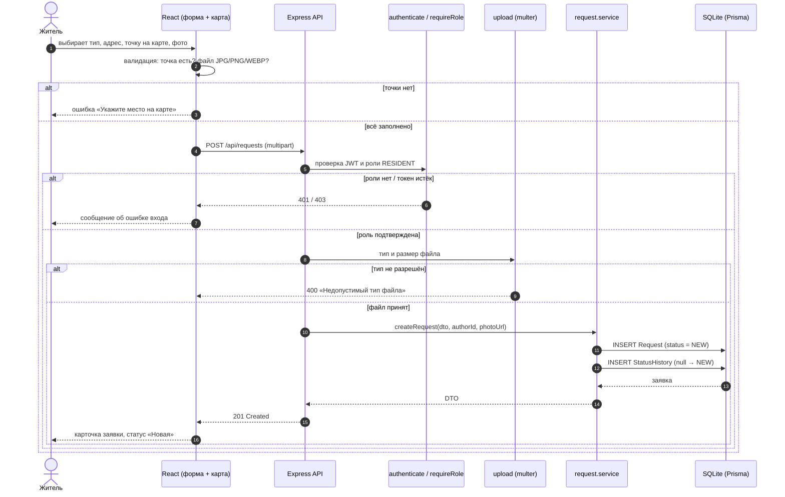
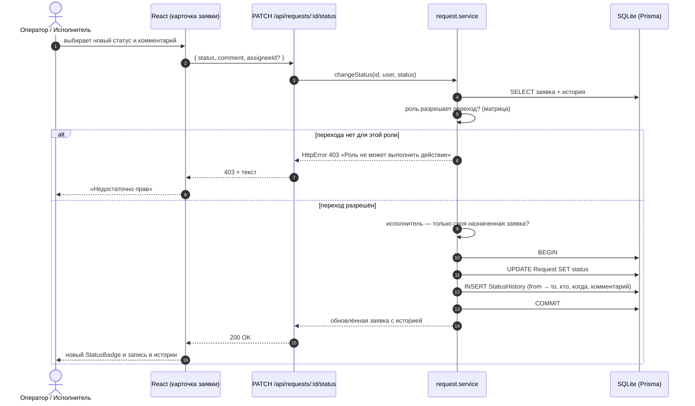
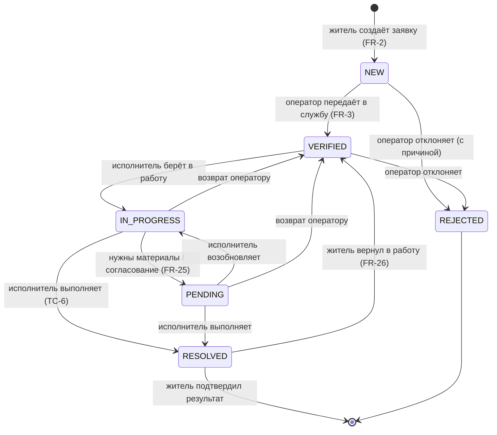

# 5. UML

Two diagram types from the presentation: **use cases** (who can do what) and **sequence**
(the order of calls for the two riskiest scenarios). Both are written in Mermaid, so they render
on GitHub and can be re-exported as PNG for the slides.

## 5.1 Диаграмма вариантов использования / Use case diagram

Notes:

- **UC8 is included by every state-changing use case** — the role is checked on the server, never
  only in the interface. This is the requirement TC-4 verifies.
- The admin has no status-change use case: sees everything, changes nothing (assumption, see
  [08-risks-and-assumptions.md](08-risks-and-assumptions.md)).

## 5.2 Последовательность: создание заявки с фото / Sequence: create a request (FR-2, TC-1…TC-3)

## 5.3 Последовательность: смена статуса с историей / Sequence: status change (FR-3, FR-4, TC-4…TC-6)

## 5.4 Состояния заявки / State machine

| Статус / Status | Подпись в интерфейсе | Кто может установить |
| --- | --- | --- |
| `NEW` | Новая / New | система при создании |
| `VERIFIED` | Проверена / Verified | Оператор (и исполнитель при возврате) |
| `IN_PROGRESS` | В процессе / In progress | Исполнитель |
| `PENDING` | Ожидает / Pending | Исполнитель (с комментарием) |
| `RESOLVED` | Выполнена / Completed | Исполнитель |
| `REJECTED` | Отклонена / Rejected | Оператор (с причиной) |

The full permission matrix is in [07-roles-and-statuses.md](07-roles-and-statuses.md).
`Отклонена` is added on top of the presentation's four statuses — the operator notes in the
presentation say the loop has no rejection state (assumption).
