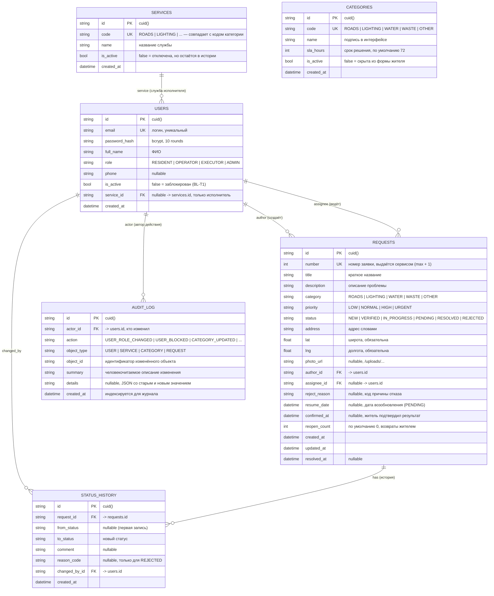

# 5. ER-диаграмма / ER diagram

Six entities cover the whole scenario: `users`, `services`, `categories`, `requests`, `status_history`,
`audit_log`. Photos are stored on disk, and only the relative URL lives in the database (assumption:
disk storage, not object storage).

The database is a single SQLite file inside the project (`backend/data/cityfix.db`, in a Docker
volume when the stack runs in containers). No database server has to be installed. SQLite has no
native `ENUM`, so the dictionaries (`role`, `status`, `category`, `priority`, `audit action`) are
stored as strings; the allowed values and the transition matrix live in one place —
[backend/src/domain.ts](../backend/src/domain.ts). Moving to PostgreSQL is a one-line provider
change plus restoring the enums.

`services` and `categories` are reference books managed by the administrator (BL-T1). They are
**never deleted** — a row that is already used gets `is_active = false`, otherwise old requests and
executors would lose their history. `audit_log` is append-only: who changed what and when.

## 5.1 Модель / Model



## 5.2 Словарь данных / Data dictionary

| Таблица | Поле | Тип | Обязательное | Правило |
| --- | --- | --- | --- | --- |
| `users` | `email` | `String` | да | уникальный индекс, нижний регистр |
| | `password_hash` | `String` | да | bcrypt, хеш никогда не уходит в ответ |
| | `role` | `String` (домен `Role`) | да | `RESIDENT` по умолчанию при регистрации |
| `requests` | `title` | `String` | да | 5…120 символов |
| | `description` | `String` | да | 10…2000 символов |
| | `number` | `Int` | да | уникальный, выдаётся при создании: `max(number) + 1` |
| | `category` | `String` (домен `Category`) | да | одна из пяти служб |
| | `status` | `String` (домен `RequestStatus`) | да | `NEW` по умолчанию, меняется только через сервис |
| | `lat` / `lng` | `Float` | да | границы: −90…90 / −180…180, иначе `400` |
| | `photo_url` | `String?` | нет | `/uploads/<file>`, тип проверен multer |
| | `assignee_id` | `String?` | нет | заполняется при `NEW → VERIFIED` |
| | `priority` | `String` (домен `Priority`) | да | `LOW` \| `NORMAL` \| `HIGH` \| `URGENT`, по умолчанию `NORMAL` |
| | `reject_reason` | `String?` | нет | код причины отказа, дублирует `reasonCode` последней записи истории |
| | `resume_date` | `DateTime?` | нет | ожидаемая дата возобновления, задаётся при `PENDING` |
| | `confirmed_at` | `DateTime?` | нет | житель подтвердил результат; флаг, а не статус |
| | `reopen_count` | `Int` | да | по умолчанию `0`, растёт при `RESOLVED → VERIFIED` |
| `users` | `is_active` | `Boolean` | да | по умолчанию `true`; `false` блокирует вход (`403`) и отзывает выданный токен (`401`) |
| | `service_id` | `String?` | нет | заполняется только исполнителю, `-> services.id` |
| `services` | `code` | `String` | да | уникальный, `^[A-Z][A-Z0-9_]{1,19}$`, совпадает с кодом категории |
| | `name` | `String` | да | 2…60 символов |
| | `is_active` | `Boolean` | да | по умолчанию `true`; отключённую службу нельзя назначить исполнителю |
| `categories` | `code` | `String` | да | уникальный, тот же шаблон, что у службы |
| | `sla_hours` | `Int` | да | 1…8760, по умолчанию `72` |
| | `is_active` | `Boolean` | да | `false` скрывает категорию из формы жителя, но старые заявки остаются |
| `audit_log` | `action` | `String` (домен `AuditAction`) | да | 12 кодов: пользователи, службы, категории, заявки, выгрузка |
| | `object_type` / `object_id` | `String` | да | `USER` \| `SERVICE` \| `CATEGORY` \| `REQUEST` + идентификатор |
| | `summary` | `String` | да | человекочитаемая строка для экрана журнала |
| | `details` | `String?` | нет | JSON `{ from, to }` — для разбора и тестов (денег и паролей здесь нет) |
| `status_history` | `from_status` | `String?` | нет | `null` для записи о создании |
| | `to_status` | `String` | да | статус, который установили |
| | `comment` | `String?` | нет | текст оператора/исполнителя |
| | `reason_code` | `String?` | нет | только для записей об отказе (`REJECT_REASONS`) |

## 5.3 Индексы и производительность / Indexes and performance (NFR-1)

```prisma
@@index([status, createdAt])   // фильтр по статусу + сортировка списка
@@index([category])            // фильтр по службе
@@index([authorId])            // «Мои заявки» жителя
@@index([assigneeId])          // задачи исполнителя
@@index([role, isActive])      // фильтр пользователей по роли и блокировке (BL-T1)
@@index([createdAt])           // audit_log: журнал всегда отдаётся от новых к старым
```

- Список всегда листается: `page` и `limit` (по умолчанию 20, максимум 100) — на 1000 записях
  сервер не отдаёт всё сразу, поэтому ответ укладывается в 2 секунды (TC-9).
- Тяжёлые поля (`description`) в списке не выбираются: карточка списка получает только
  `id, number, title, category, status, address, createdAt, photoUrl`.
- `status_history` подгружается только в карточке заявки (`GET /api/requests/:id`).

## 5.4 Начальные данные / Seed data

| Что создаётся | Количество | Зачем |
| --- | --- | --- |
| справочник категорий (`ROADS`, `LIGHTING`, `WATER`, `WASTE`, `OTHER`) | 5 | форма жителя, фильтры, SLA |
| справочник служб (те же коды, что у категорий) | 5 | привязка исполнителя через `service_id` |
| пользователи (два оператора, пять служб-исполнителей, админ, житель) | 9 | вход по ролям, проверка «чужих» заявок, смена категории |
| демонстрационные заявки с историей (все статусы, включая `PENDING` и отказ с причиной) | 6 | сквозной путь на демо и TC-1…TC-15 |
| заявки-наполнители для проверки производительности | `SEED_DEMO_REQUESTS` (по умолчанию 1000) | TC-9 / NFR-1 |
| записи журнала действий | 2 на прогон | демонстрация экрана «Журнал» (создание справочников идёт через seed) |

The seed is idempotent: users are upserted by email, categories and services by code, demo requests
are created only if the table is empty, so restarting the stack does not duplicate data.
